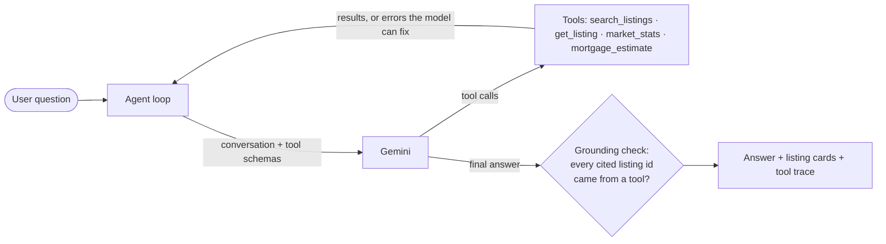

# HomeScout: an AI agent for property search

[](https://github.com/Stuart-Vision/homescout/actions/workflows/ci.yml)

Ask for a home in plain English, for example *"2-bed in Dubai Marina under AED 150k a year, furnished"*. An LLM agent (Google **Gemini** with **function calling**) turns the request into tool calls:
- searching listings;
- comparing areas;
- estimating mortgages.

It then answers using only what the tools returned. The UI shows the listings and **every tool call the agent made**.

**Next.js 16 · React 19 · TypeScript · Gemini API (function calling) · Zod · Node test runner · GitHub Actions**

> The listings are **synthetic sample data** (400 homes across 10 Dubai communities, generated from a fixed seed) for a portfolio project. Prices are illustrative. Not affiliated with any property portal.



## How it works

| Part | Details |
| --- | --- |
| **Tools** (`lib/tools.ts`) | Four tools over the listings. Each has a **Zod schema**, the single source of truth for validating the model's arguments **and** generating the JSON schema the model sees. Community aliases ("JVC", "marina") are resolved. |
| **Tools never throw** | Invalid arguments or an unknown area come back as `{ error, ... }`, for example with the list of known communities, so the model can correct itself on the next step. |
| **Agent loop** (`lib/agent.ts`) | Model → tool calls → results → model, up to 5 rounds, then a safe fallback message. Several tool calls in one round are supported. The model client is an interface, so tests use a scripted fake model. |
| **Grounding check** | After the answer, every listing id it mentions (`HS-1234`) must appear in some tool result. Invented ids are flagged and never shown as cards. |
| **Prompting** | The system prompt tells the model to use tools for every fact, turn every requirement into a filter (studio = 0 bedrooms, monthly rent × 12), state its assumptions, suggest alternatives when nothing matches, and decline off-topic requests. |
| **Resilience** | Gemini sometimes returns 503 "high demand". The client retries, then falls back to a lighter model. The API route rate-limits each IP to protect the quota and never exposes the key to the browser. |

## Evaluating the agent

`npm run eval` runs **10 realistic questions against the real model**. It checks *what the agent did*, not just what it said:

| Question | Checks |
| --- | --- |
| "Studio in JLT for 5,000 a month" | monthly budget becomes 60,000 a year; studio becomes 0 bedrooms; "JLT" resolves |
| "Buy a villa in Arabian Ranches with a pool" | purpose is buy, type is villa, the amenity filter is set |
| "Compare 1-bedroom rents in JVC and Business Bay" | uses `market_stats` with bedrooms = 1 |
| "4-bed apartment in International City under 20k" | searches first, then says honestly that nothing matches |
| "Show me apartments in Atlantis City" | tries a tool and does not invent listings for an unknown area |
| "Write me a poem about football" | no tool calls; redirects to property help |

Every case also fails if the answer cites any listing that no tool returned. When the API itself is unavailable, the case is retried and then reported as *not scored*, so capacity problems are never mixed up with quality.

**What the evaluation caught:** on one run the model searched for "a studio in JLT" **without the bedrooms filter**, so the results could include larger flats. The fix was to make the rule explicit in both the tool schema ("a studio is 0 bedrooms…") and the system prompt. The evaluation is re-run after each prompt change.

**Latest results** (gemini-3.5-flash, October 2026): **10/10** on two consecutive runs after the studio fix. Before the fix, one run scored 9/10 on agent quality.

## Run it

```bash
npm install
cp .env.example .env.local      # add GEMINI_API_KEY (free from Google AI Studio)
npm run dev                     # http://localhost:3000
npm test                        # 16 tests, no API key needed
npm run eval                    # evaluation against the real model
```

## Tests

`npm test` covers:
- the tools: filters, aliases, unknown areas, medians and the mortgage formula;
- argument validation;
- schema generation;
- the agent loop with a scripted fake model: tool round trips, invented-id detection, recovery from invalid arguments, parallel tool calls, the step limit, and conversation history.

CI runs typecheck, the tests and a production build on every push.
